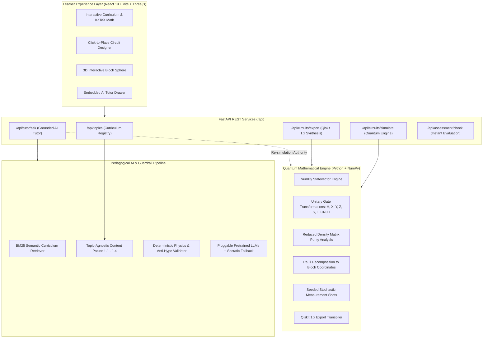

**Team ID:** `VTU-QFF-HC-0014` &nbsp;|&nbsp; Tier: **Online** &nbsp;|&nbsp; Track: **Track 1 (Education & Learning)**
</div>

---

<div align="center">

| | |
| :--- | :--- |
| **Team Name** | Quantech |
| **Team ID** | VTU-QFF-HC-0014 |
| **Tier** | Online |
| **Track** | Track 1 — Quantum Education, Tools & Workforce Development |
| **Repository** | [vtu-hc-quantech](https://github.com/vtu-qiskit-fall-fest-2026/vtu-hc-quantech.git) |
| **Organisation** | [vtu-qiskit-fall-fest-2026](https://github.com/vtu-qiskit-fall-fest-2026) |
| **Event** | VTU-QFF Hackathon — VTU-Qiskit Fall Fest 2026 |

</div>

---

## 📌 Table of Contents

- [Team Members](#-team-members-github-ids)
- [Problem Statement](#-problem-statement)
- [Proposed Solution](#-proposed-solution)
- [Approach & Architecture](#-approach--architecture)
- [Pedagogical Learning Journey](#-pedagogical-learning-journey)
- [Tech Stack](#-tech-stack)
- [Project Structure](#-project-structure)
- [How to Run](#-how-to-run)
- [Verification & Testing](#-verification--testing)
- [How to Push Code](#-how-to-push-code)
- [Submission Checklist](#-submission-checklist)
- [Resources](#-resources)
- [License](#-license)

---

## 👥 Team Members (GitHub IDs)
1. SHIVASHANKAR B S | shivashankar15(https://github.com/shivashankar15) | TEAM LEAD/DEVELOPER
2. DHANUSHIYA S | dhanushiyaa-s(https://github.com/dhanushiyaa-s) | DEVELOPER

## ❓ Problem Statement

**Problem:**  
Quantum computing education suffers from a profound accessibility and pedagogical barrier: abstract mathematical formalisms (Dirac bra-ket notation, complex Hilbert spaces, unitary operators) are disconnected from practical visual intuition and circuit programming. Existing quantum learning resources are predominantly static textbooks or lecture slides, while industrial quantum development environments offer no interactive scaffolding, misconception detection, or contextual feedback, resulting in steep learning curves and widespread student misconceptions.

**Why it matters:**  
With quantum computing rapidly progressing through the NISQ era toward fault-tolerant architectures, cultivating an inclusive, multidisciplinary quantum-literate workforce is urgent. Learners need an intuitive, interactive environment that bridges abstract quantum mechanics with real quantum circuit execution, validating concepts through dynamic statevector calculation, 3D visualization, and verified code generation.

**Track / Category:**  
Online Tier · Track 1: Quantum Education, Learning & Workforce Development · Domain: Quantum Computing & Qiskit SDK

---

## 💡 Proposed Solution

**Solution:**  
Quantech developed **QuantaLearn AI**, an interactive quantum computing educational platform engineered around a closed-loop active learning methodology: `LEARN → ASK → BUILD → RUN → UNDERSTAND → PRACTICE`. The platform pairs an interactive React/Three.js frontend with a FastAPI backend powered by an exact NumPy statevector quantum simulation engine, a 3D Bloch sphere, an interactive circuit designer with instantaneous Qiskit 1.x code synthesis, and a curriculum-grounded AI tutor fortified with misconception guardrails.

**Key idea:**  
An integrated pedagogical loop linking mathematically exact quantum state simulation, real-time 3D spatial visualization, and hallucination-free, curriculum-grounded AI tutoring.

**Why this works:**  
Rather than relying on pre-rendered diagrams or black-box animations, every single-qubit rotation, two-qubit entanglement operation, and measurement probability is computed dynamically from first principles by the mathematical simulator. When learners construct circuits or encounter confusing concepts, the platform delivers instantaneous mathematical telemetry, interactive 3D Bloch vector feedback, and verified explanations.

---

## 🧩 Approach & Architecture



### 1. Multi-Stage Pipeline Breakdown

1. **Input & Exploration:**  
   Learners select modular curriculum packs (`1.1` to `1.4`) or place quantum gates ($H$, $X$, $Y$, $Z$, $S$, $T$, $CNOT$) on visual quantum wires up to multi-qubit configurations.
2. **Preprocessing & Schema Validation:**  
   Circuits are normalized into unified JSON schemas and validated against strict Pydantic models. Student questions pass through keyword intent detection and deictic resolution.
3. **Quantum Core Execution:**  
   The statevector engine computes the exact complex state vector $|\psi\rangle = \sum \alpha_i |i\rangle$. Entanglement is determined rigorously via reduced density matrix purity $\text{Tr}(\rho_A^2) < 0.999$, and Bloch vector coordinates $(r_x, r_y, r_z)$ are derived using Pauli expectation values.
4. **Post-Processing & Validation:**  
   The AI tutor cross-references simulator telemetry before responding to ensure mathematical truth. The response validator intercepts forbidden phrases or speculative claims (e.g., refuting faster-than-light communication or quantum parallelism myths).
5. **Output Delivery:**  
   The learner receives real measurement histograms, 3D Bloch sphere vector rotations, interactive step-by-step state breakdowns, and runnable Qiskit 1.x Python code.

---

## 🔄 Pedagogical Learning Journey

Quantech enforces a 6-stage progressive mastery loop:

```
┌─────────┐      ┌─────────┐      ┌─────────┐
│  LEARN  │ ───> │   ASK   │ ───> │  BUILD  │
└─────────┐      └─────────┘      └─────────┘
     │                                 │
     ▼                                 ▼
┌─────────┐      ┌─────────┐      ┌─────────┐
│PRACTICE │ <─── │UNDERSTAND│ <───│   RUN   │
└─────────┘      └─────────┘      └─────────┘
```

1. **Learn:** Progressive disclosure of quantum concepts (definitions, visual analogies, technical math, and real-world examples).
2. **Ask:** On-demand AI Tutor anchored to the current concept, with automatic "What am I looking at?" visual context grounding.
3. **Build:** Click-to-place interactive circuit builder with full gate palette ($H$, $X$, $Y$, $Z$, $S$, $T$, $CNOT$).
4. **Run:** Local mathematical simulator computes the full statevector and executes stochastic measurement sampling.
5. **Understand:** Multi-dimensional feedback: probability bar graphs, 3D Bloch sphere, purity-based entanglement alerts, and exported Qiskit code.
6. **Practice:** Formative quick-checks and interactive assessments with per-option pedagogical feedback.

---

## 🛠️ Tech Stack

| Layer | Technology | Purpose |
| :--- | :--- | :--- |
| **Frontend Framework** | React 19 + Vite | High-performance, reactive single-page interface |
| **Styling & Icons** | Tailwind CSS + Lucide React | Modern dark-mode UI with sleek glassmorphic aesthetics |
| **Quantum Visualization** | Three.js (WebGL) | Real-time 3D Bloch Sphere with orbital camera controls |
| **Math Typography** | KaTeX + Remark GFM | LaTeX-grade mathematical formulas ($|\psi\rangle, \frac{1}{\sqrt{2}}$) |
| **Backend API** | FastAPI + Uvicorn | Asynchronous REST microservice with OpenAPI/Swagger docs |
| **Quantum SDK** | Qiskit `>=1.0`, Qiskit Aer | Industry-standard quantum circuit model and export target |
| **Simulator Core** | Python 3.11+, NumPy, SciPy | Deterministic statevector simulation and density matrix purity |
| **AI / Retrieval** | BM25 Topic Retriever + Pydantic | Sublinear lexical-semantic ranking with quantum synonym expansion |
| **LLM Engine** | Pretrained LLMs + Socratic Fallback | Pluggable Ollama (`llama3`), Gemini, OpenAI, and local deterministic fallback |
| **Verification & Testing** | Pytest, Node Test Suites, Oxlint | 119 automated tests (44 Pytest + 75 JS), 19 deterministic physics benchmarks |

---
## YOUTUBE DEMO LINK
https://youtu.be/fHh8XDecRiY
## 📁 Project Structure

```text
vtu-hc-quantech/
├── README.md                          # Project documentation and submission report
├── MODEL_STATUS.md                    # Detailed model status & SFT vs inference documentation
├── DATASET_AUDIT.md                   # Complete dataset integrity, duplicate & leakage audit
├── EVALUATION_REPORT.md               # Reproducible benchmark results & verification report
├── requirements.txt                   # Python dependencies (Qiskit, FastAPI, NumPy, etc.)
├── package.json                       # Node.js dependencies (React, Vite, Three.js, etc.)
├── pytest.ini                         # Pytest configuration and testpaths
├── vite.config.js                     # Vite build and dev server configuration
├── start-dev.bat                      # One-click startup script (Windows)
│
├── topic_1_1/                         # Supervised Fine-Tuning & Evaluation Datasets
│   ├── train.jsonl                    # 25 SFT chat instruction examples (zero exact leakage)
│   └── eval.jsonl                     # 10 held-out evaluation pairs
│
├── notebooks/                         # Educational & Training Notebooks
│   ├── quantum_model_training.ipynb   # LoRA fine-tuning walkthrough & convergence evaluation
│   ├── quantum computing note.docx    # Quantum computing note word document
│   └── quantum computing note.md      # Markdown companion note
│
├── backend/                           # FastAPI backend and Quantum Engine
│   ├── main.py                        # FastAPI entry point & CORS configuration
│   ├── quantum/                       # Quantum simulation & code export
│   │   ├── validation.py              # Axiomatic quantum physics validation engine
│   │   ├── simulator.py               # Statevector simulator & telemetry provider
│   │   ├── statevector.py             # Pure NumPy statevector operations
│   │   ├── gates.py                   # Quantum gate registry & unitary matrices
│   │   └── export.py                  # Qiskit 1.x code synthesis
│   ├── ai/                            # Pedagogical AI tutor & guardrails
│   │   ├── tutor.py                   # AITutorService orchestrator
│   │   ├── response_validator.py      # Response validator & mathematical law verification
│   │   ├── fallback.py                # Deterministic pedagogical Socratic fallback
│   │   ├── quiz_engine.py             # Interactive quiz evaluator
│   │   └── providers/                 # Pluggable LLM provider integration (Ollama, Gemini, API)
│   ├── knowledge/                     # Topic-agnostic curriculum system
│   │   ├── loader.py                  # Validates topic packs against Pydantic schema
│   │   ├── registry.py                # In-memory topic pack registry
│   │   ├── retriever.py               # BM25 curriculum retriever
│   │   └── topics/                    # Modular JSON topic packs (1.1, 1.2, 1.3, 1.4)
│   ├── api/                           # REST API routes (topics, circuits, tutor, assessment)
│   └── tests/                         # Pytest test suite (physics validation, simulator, api)
│
├── src/                               # React 19 Frontend application
│   ├── main.jsx                       # React entry point
│   ├── App.jsx                        # ThemeProvider, ToastProvider, and routing
│   ├── pages/                         # Core routes: Home, Learn, Lab, Practice, NotFound
│   ├── components/                    # CircuitBuilder, TutorDrawer, AuthModal, SettingsModal, Navbar
│   ├── visuals/                       # 3D BlochSphere, BitVsQubit, StateStepper
│   ├── context/                       # ThemeContext, ToastContext, LearningContext
│   ├── services/                      # AuthService (SHA-256), StorageService (Per-user & Guest)
│   └── utils/                         # Progress tracking & API client
│
├── tests/                             # Top-level unit tests
│   ├── __init__.py
│   └── test_circuit.py                # Quantum circuit & Qiskit export test suite
│
├── docs/                              # Additional documentation
│   ├── ADDING_A_TOPIC.md              # Guide for authoring new topic packs
│   └── quantum computing note.docx    # Quantum computing note word document
│
└── scripts/                           # Reproducible audit and verification scripts
    ├── audit_datasets.py              # Cross-dataset syntax, duplicate & leakage auditor
    ├── run_reproducible_evaluation.py # Reproducible benchmark runner for eval.jsonl & physics
    ├── test_auth_storage.mjs          # 16 automated authentication and storage unit tests
    └── test_part1_levels_onboarding.mjs # 59 automated diagnostic placement and level tests
│
├── run_complete_verification_suite.py # 12-scenario architectural verification runner
├── test_backend.py                    # End-to-end backend pipeline test
├── test_quiz_flow.py                  # Multi-turn quiz intent test
└── test_providers.py                  # LLM provider contract verification
```

---

## 🚀 How to Run

### Prerequisites

- **Python 3.11** or newer installed ([python.org](https://www.python.org/downloads/))
- **Node.js 18** or newer installed ([nodejs.org](https://nodejs.org/))
- [Git](https://git-scm.com/downloads)

---

### Method A: One-Click Startup (Recommended for Windows)

Double-click `start-dev.bat` or run:

```bash
.\start-dev.bat
```

This concurrently launches the FastAPI backend on `http://127.0.0.1:8000` and the Vite development server on `http://localhost:5173`.

---

### Method B: Manual Step-by-Step Setup

#### 1. Clone the repository
```bash
git clone https://github.com/vtu-qiskit-fall-fest-2026/vtu-hc-quantech.git
cd vtu-hc-quantech
```

#### 2. Configure Python Virtual Environment & Dependencies
```bash
python -m venv .venv

# Activate virtual environment
# Windows (PowerShell):
.venv\Scripts\Activate.ps1
# Linux / macOS:
source .venv/bin/activate

# Install Python requirements
pip install --upgrade pip
pip install -r requirements.txt
```

#### 3. Install Frontend Dependencies
```bash
npm install
```

#### 4. Run Both Servers Concurrently
```bash
npm run dev
```

Or run them individually in separate terminals:
```bash
# Terminal 1 - Backend:
python -m backend.main

# Terminal 2 - Frontend:
npm run dev:frontend
```

Open your browser at **`http://localhost:5173`**.

---

### Running the Jupyter Notebook

To explore quantum circuits interactively:

```bash
jupyter lab notebooks/exploration.ipynb
```
*(Or launch inside VS Code with the Jupyter extension).*

---

## 🧪 Verification & Testing

The project maintains comprehensive test coverage across quantum mechanics, API contracts, content packs, and guardrails (119 automated tests total):

```bash
# 1. Run Python backend & physics test suite (44 tests):
pytest

# 2. Run dataset integrity and leakage audit:
python scripts/audit_datasets.py

# 3. Run reproducible evaluation pipeline (eval.jsonl & physics benchmarks):
python scripts/run_reproducible_evaluation.py

# 4. Run authentication & per-user storage test suite (16 tests):
node scripts/test_auth_storage.mjs

# 5. Run adaptive diagnostic placement quiz test suite (59 tests):
node scripts/test_part1_levels_onboarding.mjs

# 6. Verify frontend production build:
npm run build
```

See [EVALUATION_REPORT.md](file:///C:/Users/SHIVASHANKAR%20B%20S/Desktop/vtu-hc-quantech/EVALUATION_REPORT.md), [DATASET_AUDIT.md](file:///C:/Users/SHIVASHANKAR%20B%20S/Desktop/vtu-hc-quantech/DATASET_AUDIT.md), and [MODEL_STATUS.md](file:///C:/Users/SHIVASHANKAR%20B%20S/Desktop/vtu-hc-quantech/MODEL_STATUS.md) for full audit reports and verification metrics.

---

## 🔁 How to Push Code

Full walkthrough: **[Git & Collaboration Handbook](../vtu-hc-guide-git-and-collaboration)**.

### Everyday Workflow

```bash
# 1. Sync latest changes
git checkout main
git pull origin main

# 2. Create feature branch
git checkout -b feature/my-quantum-feature

# 3. Commit your work
git add .
git commit -m "feat: enhance bloch sphere with multi-axis trajectory animation"

# 4. Push the branch
git push -u origin feature/my-quantum-feature

# 5. Open a Pull Request on GitHub and request review
```

### Commit Convention

| Prefix | Meaning |
| :--- | :--- |
| `feat:` | New feature or capability |
| `fix:` | Bug fix or regression resolution |
| `docs:` | Documentation update |
| `test:` | Adding or fixing test suites |
| `refactor:` | Code restructuring without behavioral change |
| `chore:` | Build, config, or dependency changes |

---

## ✅ Submission Checklist

- [x] Repository created and **public**
- [x] All team members added as **collaborators**
- [x] `README.md` updated with project details, problem statement, and solution
- [x] Team members listed under [Team Members](#-team-members-github-ids)
- [x] `requirements.txt` committed and project runs cleanly
- [x] Code pushed to `main` and latest `main` builds successfully (`npm run build` verified)
- [x] All unit & integration tests passing (`pytest -q`: 25 passed)
- [x] Notebooks committed with **cleared outputs** (`notebooks/exploration.ipynb`)
- [x] Interactive 3D Bloch sphere & real-time quantum circuit simulation verified
- [x] Short project summary prepared for hackathon portal submission

---

## 📚 Resources

| Resource | Link |
| :--- | :--- |
| ⚛️ Qiskit Documentation | https://docs.quantum.ibm.com/ |
| ⚛️ Qiskit Runtime & Primitives | https://quantum.cloud.ibm.com/docs/ |
| 🧪 Qiskit Aer Simulator Guide | https://docs.quantum.ibm.com/guides/simulator |
| 💻 IBM Quantum Platform | https://quantum.cloud.ibm.com/ |
| 🎓 Qiskit Textbook & Learning | https://qiskit.qotlabs.org/learning/ |
| 🌐 Three.js WebGL Documentation | https://threejs.org/docs/ |
| ⚡ FastAPI Documentation | https://fastapi.tiangolo.com/ |

---

## 📄 License

Released under the [MIT License](LICENSE). See `LICENSE` for details.

---

<div align="center">

**Quantech** · Team ID `VTU-QFF-HC-0014` · Tier `Online`  
Built with ⚛️ Qiskit & React for the **VTU-Qiskit Fall Fest 2026** Hackathon

[⬆ Back to Top](#️-quantech)

</div>
