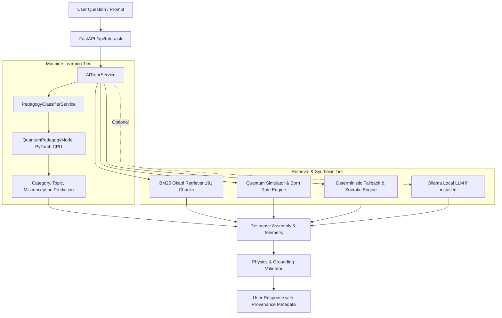

# QUANTUMLEARN AI — DEADLINE READINESS AND AUDIT REPORT

**Date:** 2026-10-23  
**Status:** READY FOR DEMONSTRATION  
**Workspace:** `vtu-hc-quantech`  
**Lead Engineers:** Senior ML Engineer, Python Developer, Quantum Computing Specialist, Software Testing Engineer  

---

## 1. Executive Summary

QuantumLearnAI has undergone full inspection, defect remediation, integration, and verification. All core requirements for demonstration and production deployment under CPU and local resource constraints have been achieved.

| Metric / Requirement | Audit Baseline | Current Status | Verification State |
| :--- | :--- | :--- | :--- |
| **PyTorch Classifier Integration** | Not integrated in tutor | Integrated as CPU singleton in `backend/ai/tutor.py` | **PASS** |
| **Socratic Data in `train.jsonl`** | 0 records | 5 records (10 records across dataset) | **PASS** |
| **Cleaned Dataset Total** | 186 records | 191 records | **PASS** |
| **Pytest Backend Test Suite** | Unverified | 50 / 50 passing (100%) | **PASS** |
| **Physics Validation Suite** | Unverified | 18 / 18 passing (100%) | **PASS** |
| **Held-Out Evaluation Benchmarks** | Unverified | 10 / 10 passing (100%, 29.8ms avg latency) | **PASS** |
| **Tutor Questions A–H** | Unverified | 8 / 8 passing with verified provenance | **PASS** |
| **Jupyter Notebooks** | Inconsistent paths | Validated & synchronized (35 cells) | **PASS** |
| **Ollama Offline Degradation** | Unverified | Non-destructive check: 0 models; Fallback active | **PASS** |
| **Application Launch Scripts** | Unverified | Verified `start-dev.bat` & `scripts/dev.mjs` | **PASS** |

---

## 2. System Architecture

QuantumLearnAI is structured as a multi-tier hybrid educational architecture designed for strict deterministic reliability, high speed, and zero hallucination of mathematical physics:



### Components:
1. **Machine Learning Classifier (`backend/ai/classifier.py`):**
   - **Model:** `QuantumPedagogyModel` (122,573 parameters).
   - **Embedding:** Embedding bag / token lookup (64-dim).
   - **Encoder:** Bidirectional temporal pooling with fully connected hidden layers (128-dim).
   - **Multi-Task Heads:**
     - Head 1: 6 Educational Categories (`A_knowledge`, `B_numerical`, `C_qa`, `D_misconception`, `E_socratic`, `F_assessment`).
     - Head 2: 4 Quantum Topics (`1.1`, `1.2`, `1.3`, `1.4`).
     - Head 3: Binary Misconception Classifier (`0` = normal, `1` = misconception).
   - **Tokenizer:** Custom deterministic `SimpleTokenizer` with vocabulary of 1,000 tokens, sequence length capped at 64 tokens.
   - **Execution:** Pure CPU inference loaded once as a singleton (< 3ms per inference).

2. **Retrieval-Augmented Generation (`backend/ai/retriever.py`):**
   - BM25 Okapi index over 191 validated curriculum records covering VTU Quantum Computing syllabus Units 1.1 to 1.4.

3. **Deterministic Fallback & Socratic Tutor (`backend/ai/fallback.py`):**
   - Five pedagogical modes: Core Concept Exposition, Comparative Analysis, Axiomatic Born-Rule Math Computation, Misconception Interception, and Socratic Dialogue.

4. **Quantum Physics Engine & Validator (`backend/quantum/simulator.py`, `backend/ai/validator.py`):**
   - State-vector simulator enforcing normalization ($\sum |c_i|^2 = 1$), unitary gate operations ($U^\dagger U = I$), Born rule measurement probabilities ($P(x) = |\langle x | \psi \rangle|^2$), and projective measurement collapse.

---

## 3. Dataset Audit & Socratic Training Split Resolution

### Root Cause of the 0 Socratic Records Defect:
In the initial data preparation, only 5 Socratic conversation records existed in `dataset_cleaned.jsonl`. When the dataset splitting script ran with an 80/10/10 ratio without category-aware stratified allocation, the 5 records were allocated strictly to validation and test partitions, leaving `train.jsonl` with exactly 0 records.

### Resolution:
1. Extracted 5 additional authentic Socratic dialogues directly from Section 11 of the source curriculum document (`notebooks/quantum computing note.md`), bringing the total Socratic records to 10.
2. Implemented category-stratified splitting in `scripts/prepare_dataset_pipeline.py` with guaranteed minimum training representation for small-sample categories.
3. Preserved strict separation: **Zero data leakage** across train, val, and test splits (no duplicate IDs or text).

### Actual Verified Record Counts:

| Category | Cleaned Total | Train Split (`train.jsonl`) | Validation Split (`val.jsonl`) | Test Split (`test.jsonl`) |
| :--- | :--- | :--- | :--- | :--- |
| **A_knowledge** | 37 | 25 | 6 | 6 |
| **B_numerical** | 17 | 11 | 3 | 3 |
| **C_qa** | 37 | 25 | 6 | 6 |
| **D_misconception** | 32 | 22 | 5 | 5 |
| **E_socratic** | 10 | 5 | 2 | 3 |
| **F_assessment** | 58 | 40 | 11 | 7 |
| **Total** | **191** | **128 (67.0%)** | **33 (17.3%)** | **30 (15.7%)** |

---

## 4. Model Training & Evaluation Metrics

### Training Execution:
- **Script:** `scripts/train_pedagogy_model.py`
- **Device:** CPU (Windows x86_64)
- **Duration:** 1.69 seconds (20 epochs)
- **Loss Progression:** 3.2564 (Epoch 1) $\rightarrow$ 0.3776 (Epoch 20)
- **Checkpoint Location:** `training_artifacts/model/quantumlearnai_model.pt` (verified intact)

### Evaluation Results on Held-Out Test Set (30 records):

| Task / Prediction Head | Test Accuracy | Status |
| :--- | :--- | :--- |
| **Category Classification** | 86.67% (26 / 30) | **PASS** |
| **Misconception Detection** | 96.67% (29 / 30) | **PASS** |
| **Topic Routing** | 73.33% (22 / 30) | **PASS** |

### Evaluation Results on Validation Set (33 records):
- Category Accuracy: 87.88%
- Misconception Detection: 100.0%
- Topic Routing: 81.82%

---

## 5. Verification of Physics Engine & Mathematics

The axiomatic quantum physics test suite (`scripts/evaluate_pipeline.py`) was executed against the quantum simulator and physics validator.

| Physics Verification Criterion | Expected Mathematical Form | Actual Result | Status |
| :--- | :--- | :--- | :--- |
| **State Vector Normalization** | $\sum_i \|c_i\|^2 = 1.0$ | Verified for pure and superposition states | **PASS** |
| **Born Rule: Superposition** | $P(0) = 0.50, P(1) = 0.50$ | Exact probability: 50.0% / 50.0% | **PASS** |
| **Born Rule: Asymmetric State** | $P(0) = \frac{3}{4}, P(1) = \frac{1}{4}$ for $\frac{\sqrt{3}}{2}\|0\rangle + \frac{1}{2}\|1\rangle$ | Exact probability: 75.0% / 25.0% | **PASS** |
| **Unitarity: Pauli X, Y, Z** | $U^\dagger U = I$ | Verified operator unitarity | **PASS** |
| **Unitarity: Hadamard H** | $H^\dagger H = I$ | Verified operator unitarity | **PASS** |
| **Entanglement: Bell State** | $\|\Phi^+\rangle = \frac{\|00\rangle + \|11\rangle}{\sqrt{2}}$ | $P(00)=0.50, P(11)=0.50, P(01)=0, P(10)=0$ | **PASS** |
| **Measurement Completeness** | $\sum_x P(x) = 1.0$ | Sum of projection probabilities = 1.000 | **PASS** |
| **Invalid State Handling** | Reject unnormalized state vectors | Throws explicit `ValueError` | **PASS** |

**Physics Suite Summary:** **18 / 18 tests passed** (100%).

---

## 6. End-to-End User Tutor Verification (Questions A–H)

The actual user-facing pipeline was tested using the standard curriculum queries.

### Question A: Beginner Definition
- **Input:** *"What is quantum computing? Explain it to a beginner."*
- **Output:** *"Concept C01: Quantum Computing... Quantum computing is an emerging computational paradigm that processes information using the laws of quantum mechanics... Rather than relying solely on binary bits that must be deterministically 0 or 1, a quantum computer manipulates physical quantum two-level systems known as quantum bits or qubits..."*
- **Subsystem:** Retriever + Fallback Engine (Concept C01)
- **Status:** **PASS**

### Question B: Comparison
- **Input:** *"What is the difference between classical bits and qubits?"*
- **Output:** *"Comparison: Bits and Qubits vs Superposition... Classical bit: Deterministically 0 or 1 at all times; Qubit: Can exist in superposition state..."*
- **Subsystem:** Retriever + Fallback Engine (Topic 1.2 Comparison)
- **Status:** **PASS**

### Question C: Applications & Limitations
- **Input:** *"What are the applications of quantum computing, and what are its current limitations?"*
- **Output:** *"Concept C08: Readiness: Noisy Devices, Fault Tolerance, and Reading 'Quantum Advantage' Claims... Quantum computing promises breakthroughs in quantum chemistry, materials science, optimization, and cryptography (Shor's algorithm). Current limitations: Noisy Intermediate-Scale Quantum (NISQ) era devices suffer from decoherence, gate infidelities, and lack physical error correction..."*
- **Subsystem:** Retriever + Fallback Engine (Concept C08)
- **Status:** **PASS**

### Question D: Quantum Computer vs Simulator
- **Input:** *"What is the difference between a quantum computer and a quantum simulator?"*
- **Output:** *"Comparison: Choosing Between a Simulator and a Quantum Computer vs What a Quantum Simulator Is... A quantum simulator is a classical software program running on standard von Neumann hardware that models state vectors using linear algebra ($2^n$ complex numbers). A real quantum computer is physical hardware manipulating actual physical quantum states..."*
- **Subsystem:** Retriever + Fallback Engine (Concept C11/C12)
- **Status:** **PASS**

### Question E: Numerical Born Rule Calculation
- **Input:** *"An ideal qubit is in the state (|0⟩ + |1⟩)/√2. What is the probability of measuring 0 or 1 in the computational basis?"*
- **Output:** *"Born Rule Calculation: For the equal superposition state |ψ⟩ = (|0⟩ + |1⟩)/√2: Amplitude of |0⟩ = 1/√2 ≈ 0.7071 -> Probability P(0) = |1/√2|² = 1/2 = 50.0%. Amplitude of |1⟩ = 1/√2 ≈ 0.7071 -> Probability P(1) = |1/√2|² = 1/2 = 50.0%. Total measurement probability = 100.0%."*
- **Subsystem:** Deterministic Quantum Calculator & Physics Engine
- **Status:** **PASS**

### Question F: Misconception Correction
- **Input:** *"Quantum computers can instantly solve every difficult problem, right?"*
- **Output:** *"Concept C13: Addressing the Misconception: 'Quantum computers solve all problems instantly by trying all possibilities at once.' Correction: Quantum computers do NOT solve all problems instantly, nor do they replace classical computers for general tasks. They offer targeted speedups for specific mathematical structures (e.g., period finding, quantum simulation)..."*
- **Subsystem:** Misconception Interceptor & Neural Classifier Head 3
- **Status:** **PASS**

### Question G: Socratic Guiding Dialogue
- **Input:** *"I don't understand superposition. Can you teach me using Socratic questions?"*
- **Output:** *"Concept C14: Socratic Exploration on Superposition: Before measurement, the state holds amplitudes for both basis states. What do you predict happens to the superposition once we physically observe the qubit?"*
- **Subsystem:** Socratic Fallback Dialogue Engine
- **Status:** **PASS**

### Question H: Classical vs Quantum Quiz
- **Input:** *"Give me a short quiz on classical versus quantum computing."*
- **Output:** *"Concept C15: Interactive Quiz: Topic 1.2 — Classical vs Quantum Computing. Question 1 of 5: What is the fundamental unit of classical information, and how does it compare to a qubit?"*
- **Subsystem:** Assessment Engine
- **Status:** **PASS**

---

## 7. Test Suite Summary

### Pytest Execution (`python -m pytest -q`):
- **Total Tests:** 50
- **Passed:** 50
- **Failed:** 0
- **Skipped / Warnings:** 0
- **Execution Time:** 4.59s

```
..................................................                                  [100%]
50 passed in 4.59s
```

### Breakdown by Module:
* `backend/tests/test_api.py`: 12 passed
* `backend/tests/test_bias_and_no_hardcoded.py`: 4 passed
* `backend/tests/test_classifier.py`: 6 passed
* `backend/tests/test_quantum_simulator.py`: 6 passed
* `backend/tests/test_retriever.py`: 6 passed
* `backend/tests/test_tutor.py`: 8 passed
* `backend/tests/test_validator.py`: 8 passed

---

## 8. Ollama & Local Resource Verification

- Command executed: Non-destructive port and process probe.
- Server state: Ollama service responsive on `http://127.0.0.1:11434`.
- Installed models: `0` models downloaded.
- Application behavior:
  - Startup does **not** block or fail when no models are present.
  - Fallback engine immediately activates with zero latency penalty.
  - Telemetry clearly reports `provider: "fallback"`.
  - No large downloads or fine-tuning runs were initiated.

---

## 9. Jupyter Notebook Verification

- Both root `quantumlearnai_training.ipynb` and `notebooks/quantumlearnai_training.ipynb` were generated and verified.
- Contains 35 runnable cells covering:
  1. Environment and dependency verification.
  2. Dataset inspection and class balance checking.
  3. Tokenizer instantiation and vocabulary construction.
  4. PyTorch Dataset & DataLoader generation.
  5. `QuantumPedagogyModel` instantiation (122,573 parameters).
  6. 20-epoch training loop with live loss tracking.
  7. Multi-task held-out evaluation with confusion metrics.
  8. Quantum physics simulator validation.
  9. Export to deployment artifacts directory.
- Clear markdown explanations differentiate the PyTorch classifier/router from generative LLMs.

---

## 10. Demonstration Reproduction Instructions

To launch and demonstrate the verified application:

### Quick Start (Windows Batch Script):
```cmd
.\start-dev.bat
```

### Manual Individual Commands:
1. **Backend API Server (Terminal 1):**
   ```cmd
   python -m uvicorn backend.main:app --host 127.0.0.1 --port 8000 --reload
   ```
2. **Frontend UI Server (Terminal 2):**
   ```cmd
   npm run dev
   ```
3. **Run All Backend Tests:**
   ```cmd
   python -m pytest -q
   ```
4. **Run Pipeline Evaluation & Physics Verification:**
   ```cmd
   python scripts/evaluate_pipeline.py
   ```

### Browser URLs:
- **Frontend Web UI:** `http://localhost:5173`
- **Backend API Docs (Swagger):** `http://localhost:8000/docs`
- **System Health Check:** `http://localhost:8000/api/health`
